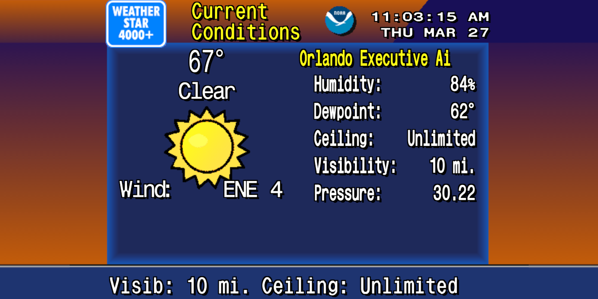

# WeatherStar 4000+

A modern, browser-based recreation of The Weather Channel's early-90s **WeatherStar 4000** local forecast — the blue-and-orange graphics, the smooth-jazz music, the endless scroll of your regional weather — driven by the live [NOAA/NWS API](https://www.weather.gov/documentation/services-web-api).

This is an enhanced fork of [netbymatt/ws4kp](https://github.com/netbymatt/ws4kp) ([original live here](https://weatherstar.netbymatt.com)) that adds an Air Quality display, a reworked Regional Forecast, server-first container deployment, and bundled music — see [What's added in this fork](#whats-added-in-this-fork).

---

## What it is

It chases the *feel* of the 90s — a low-fuss app that looks and sounds like The Weather Channel did then, on today's data. It is **not** a hardware-accurate emulator — for that, see the [WS4000 Simulator](http://www.taiganet.com/). Some screens differ from the original because more (or less) forecast data is available now than in the 90s.

Because the data comes from NOAA, WeatherStar 4000+ works for **US locations only**. For international weather, see the [`ws4kp-international`](https://github.com/mwood77/ws4kp-international) fork by [@mwood77](https://github.com/mwood77).

## What it does

A rotating set of forecast "displays," most toggle-able on the page:

- **Current Conditions** and **Latest Observations**
- **Local Forecast** and **Extended Forecast** (several days)
- **Hourly Graph** (temperature, clouds, precip for the next 36 h) and an **Hourly Forecast**
- **Regional Forecast** map — user-centered, denser city selection *(reworked in this fork)*
- **Air Quality** *(new in this fork; key-free [Open-Meteo](https://open-meteo.com/) data)*
- **Travel Cities**, **Almanac**, **Radar**, **Hazards**, and the **SPC Severe-Weather Outlook**
- **Future Radar** — forecast radar reflectivity for the next several hours from NOAA's [HRRR](https://rapidrefresh.noaa.gov/hrrr/) model (continental US only)
- Retro **background music**, scan-line CRT effect, kiosk mode, and shareable permalinks

## Data sources

All weather data comes from free, public services (the server proxies and caches them; in static mode the browser calls them directly):

| Source | Used for |
|---|---|
| **[NOAA / National Weather Service API](https://www.weather.gov/documentation/services-web-api)** — `api.weather.gov`, `forecast.weather.gov` | Forecasts, current conditions, observations, and hazards/alerts |
| **[NWS Radar](https://radar.weather.gov/)** + **[Iowa Environmental Mesonet](https://mesonet.agron.iastate.edu/)** — `radar.weather.gov`, `mesonet.agron.iastate.edu` | Radar imagery (Mesonet is the default tile source; override with `RADAR_HOST`) |
| **[NOAA Storm Prediction Center](https://www.spc.noaa.gov/)** — `www.spc.noaa.gov` | The severe-weather (SPC) outlook |
| **[HRRR Zarr archive](https://mesowest.utah.edu/html/hrrr/)** (University of Utah, on AWS) — `hrrrzarr.s3.amazonaws.com` | Forecast reflectivity for **Future Radar** |
| **[Open-Meteo Air Quality API](https://open-meteo.com/en/docs/air-quality-api)** — `air-quality-api.open-meteo.com` | US AQI for the **Air Quality** display *(added in [#7](https://github.com/jacaudi/ws4kp/pull/7))* — key-free |

## Quick start

Requires [Go](https://go.dev/dl/) 1.27.3+, [Node.js](https://nodejs.org/) 24 and [Task](https://taskfile.dev/installation/).

```bash
git clone https://github.com/jacaudi/ws4kp.git
cd ws4kp
npm --prefix web ci
task dev
```

Then open **http://localhost:8080/** and search for a US location.

## Running it

WeatherStar 4000+ runs as a **server deployment** by default: a single Go binary that serves the site built into it, with a caching proxy in front of the weather APIs — it de-duplicates and caches requests, so many viewers make few upstream calls.

**Run modes** — run these from the repo root; all serve at `http://localhost:8080/`:

| Command | Mode | Caching proxy |
|---|---|---|
| `task dev` | development — individual modules from disk, easiest debugging | ✅ |
| `npm --prefix web run build && go run ./cmd/ws4kp` | production — the minified bundles built into the binary | ✅ |
| `STATIC=1 task dev` | development, browser calls the weather APIs directly | ❌ |
| `STATIC=1 go run ./cmd/ws4kp` | simulates the static deployment (build first) | ❌ |

**With Docker** — the default image is the server build:

```bash
docker build -t ws4kp .
docker run -p 8080:8080 ws4kp
```

Or pull a prebuilt multi-arch image (amd64 + arm64) — `:latest` from `main`, `:vX.Y.Z` for releases, `:sha-<short>` for any build:

```bash
docker run -p 8080:8080 ghcr.io/jacaudi/ws4kp:latest
```

**With Docker Compose:**

```yaml
services:
  ws4kp:
    build: .            # or image: ghcr.io/jacaudi/ws4kp:latest
    ports:
      - 8080:8080
    restart: unless-stopped
    environment:
      # Any permalink parameter can seed a default via WSQS_ (see docs/deployment.md)
      - WSQS_latLonQuery=Orlando International Airport Orlando FL USA
```

## Configuration

Seed a default location and display set with `WSQS_` environment variables (handy for kiosks/dashboards): take any [permalink](#using-it) parameter, replace `-` with `_`, and prefix `WSQS_` — e.g. `-e WSQS_latLonQuery="Orlando International Airport"` and `-e WSQS_kiosk=true`. Values can also come from a `.env` file in the server's working directory. Full reference — plus dev/prod modes and the archived static image — is in **[docs/deployment.md](docs/deployment.md)**.

## Using it

- **Access:** open `http://localhost:8080/`, search a location, and use the tabs below the player: **Displays** (turn each display on or off), **Settings**, **Share**, and **Headend** (what the forecast is built from, with a copy button for issue reports).
- **Permalinks:** on the **Share** tab, click *Copy permalink* to capture your exact configuration and location as a shareable/bookmarkable URL. You can also hand-build one — omitted settings fall back to defaults:
  ```
  http://localhost:8080/?latLonQuery=Orlando+International+Airport&units-select=metric&kiosk=true
  ```
- **Kiosk mode:** a full-screen, controls-hidden view for dashboards/signage — toggle on the page or append `&kiosk=true`. Exit with **Ctrl-K** or reload.

**Settings at a glance:**

| Setting | What it does |
|---|---|
| **Speed** | Playback speed, "Very Fast" (2×) → "Very Slow" (0.67×) |
| **Display Mode** | Standard (4:3), Widescreen (16:9), Widescreen Enhanced, Portrait Enhanced |
| **Kiosk / Sticky Kiosk** | Full-screen view now / persisted across visits (for Home-Screen apps) |
| **Scan Lines** | Retro CRT scan-line effect |
| **Units** | US ↔ metric (some NWS text products keep embedded units) |
| **Volume** | Audio level when music is enabled |

Full details on permalinks, kiosk/PWA install, keyboard shortcuts, every setting, and custom scrolling text are in **[docs/usage.md](docs/usage.md)**.

## Music

The build ships with 23 AI-generated, WeatherStar-inspired tracks from two [ws4kp-music](https://github.com/netbymatt/ws4kp-music) albums (stored via **Git LFS** and **baked into the container image**), so music plays out of the box. Drop your own `.mp3` files in `web/server/music/` — or bind-mount a folder over `/app/server/music` in Docker — to override them.

The albums are licensed differently: *Latest Observations* is CC BY 4.0 (*Music from [ws4kp-music](https://github.com/netbymatt/ws4kp-music) by netbymatt, [CC BY 4.0](https://creativecommons.org/licenses/by/4.0/)*), while *Current Conditions* is owned by Suno and is for non-commercial use only. See [docs/music.md](docs/music.md#licensing) before using the music commercially.

Adding/replacing music, the autoplay rules browsers enforce, and static-mode scanning are covered in **[docs/music.md](docs/music.md)**.

## What's added in this fork

Beyond the upstream project, this fork adds:

- **Air Quality display** — key-free Open-Meteo AQI, works in both server and static modes.
- **User-centered Regional Forecast** — nearest-N ranked city selection with a junk filter and label-collision handling, plus AK/HI projection fixes.
- **Server-first deployment** — the caching server image is the default; the static nginx build is archived under [`.archive/static/`](.archive/static/).
- **Bundled music via Git LFS**, and **automated releases** (release-please → SemVer tags, changelog, and `vX.Y.Z` container images).

## Project layout

| Path | What's there |
|---|---|
| `cmd/ws4kp/` | The server binary: flags, the `healthcheck` subcommand, startup and shutdown |
| `internal/` | The server: `config` (flags, env, `.env`), `server` (routes, index injection, static files), `proxy` (the caching proxy), `playlist` (the music list) |
| `web/server/scripts/modules/` | The browser app: one module per display, orchestrated by `navigation.mjs` over a `WeatherDisplay` base class |
| `web/server/styles/scss/` | SCSS sources (compiled to CSS by the build) |
| `web/server/music/default/` | Bundled music (Git LFS) baked into the image |
| `web/datagenerators/` | Build-time scripts and their baked JSON (weather stations, regional cities) |
| `.archive/static/` | The archived static (nginx) deployment |
| `taskfile.yml`, `.taskfiles/` | Every check and build, run the same way locally and in CI (`task ci`) |
| `.github/` | CI workflows, the shared setup action, Renovate and release-please config, the `main` ruleset |
| `docs/` | The guides linked below |

## Tech stack

| Layer | What it uses |
|---|---|
| Server | Go 1.27 (one static binary that embeds the built site), Cobra + Viper, `log/slog`; distroless `nonroot` image |
| Browser app | Plain ES modules, hand-written HTML and SCSS, built with Node 24 + Gulp + Webpack + Sass + EJS |
| Checks | golangci-lint (with gosec and staticcheck), govulncheck, eslint, a `tsc --checkJs` ratchet, `go test -race`, `node --test`, a Puppeteer integration test |
| CI/CD | GitHub Actions calling [Task](https://taskfile.dev/) targets, one required check (`ci`), release-please releases, multi-arch images on GHCR, Renovate |

---

## Documentation

In-depth guides live in [`docs/`](docs/):

| Guide | What's inside |
|---|---|
| **[Deployment](docs/deployment.md)** | Server vs. static, dev/prod modes, Docker & Compose, archived nginx image, `WSQS_` environment variables |
| **[Kubernetes](docs/kubernetes.md)** | Deploy on a cluster with the bjw-s app-template chart (Helm + Flux) |
| **[Usage & settings](docs/usage.md)** | Permalinks, kiosk mode, iOS/Android PWA install, every setting, custom scrolling text |
| **[Music](docs/music.md)** | Bundled tracks (Git LFS), adding/overriding music, autoplay behavior, static-mode scanning |
| **[Development & customization](docs/development.md)** | Tech stack, build system, the `custom.js` / `custom.mjs` hook, releases & CI |
| **[FAQ & community](docs/faq.md)** | Outside-the-USA, the full-moon icon, phone apps, reporting issues, related & community projects |

---

## Acknowledgements

- **[Matt (netbymatt)](https://github.com/netbymatt)** — the maintainer of
  [ws4kp](https://github.com/netbymatt/ws4kp), which this project is forked from. Nearly all of
  WeatherStar 4000+ — the displays, the data plumbing, the look and feel — is his work and is kept
  largely intact here; this fork only adds a few displays and a container/release setup.
  Thank you for building it and keeping it open!
- **[Mike Battaglia (vbguyny)](https://github.com/vbguyny/ws4kp)** — the creator of the original
  WeatherStar 4000 web project (which Matt forked in 2020) and the code that draws the weather
  displays and the background maps. Thank you for the foundation the whole project rests on!
- **The team at [TWCClassics](https://twcclassics.com/)** — for the WeatherStar 4000
  [fonts](https://twcclassics.com/downloads.html) and [icon sets](https://twcclassics.com/downloads.html)
  and for meticulously documenting the original hardware. Icons by Charles Abel, Nick Smith, and
  Malek Masoud; fonts originally by Nick Smith. Thank you for preserving the look of the era!
- **The ws4kp community** — for the contributions, forks, and write-ups linked in
  [docs/faq.md](docs/faq.md). Thank you for keeping retro forecasts alive!

## Disclaimer

This site should **NOT** be used in life-threatening weather situations, or be relied on to inform the public of such situations. The Internet is an unreliable network subject to outages and is not suitable for mission-critical use. If you require reliable access to NWS data, please consider one of their subscription services. The authors shall not be held liable for injury, death, or property damage resulting from disregarding this warning.

The WeatherSTAR 4000 unit and technology is owned by The Weather Channel. This is a free, non-profit work by fans; all background graphics were created from scratch.
